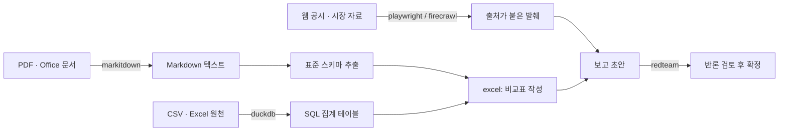

# AX Ops MCP Toolkit

A project-scoped MCP configuration and three workflow recipes for operations work: reading quotations and contracts, aggregating cost data, and drafting sourced reports with an adversarial review step.

운영(Operations) 업무에서 반복되는 세 가지 일, 곧 문서 판독, 원가 데이터 집계, 보고 초안 작성을 AI 에이전트에 맡길 때 쓰는 MCP 구성과 작업 절차를 정리한 저장소다. 이 저장소에는 MCP 서버의 코드가 없다. 서버는 모두 각 제작자의 공개 저장소에서 내려받아 실행하며, 여기에는 설정 파일과 사용 절차만 둔다.



## 구성

`.mcp.json`은 이 폴더를 Claude Code로 열 때만 적용되는 프로젝트 단위 설정이다. 전역 설정은 건드리지 않는다.

| 서버 | 하는 일 | 운영 업무에서의 쓰임 | 출처 · 라이선스 |
|---|---|---|---|
| `markitdown` | PDF, Word, Excel, PowerPoint를 Markdown으로 변환 | 견적서·계약서·보고서를 모델이 읽을 수 있는 텍스트로 바꾸기 | [microsoft/markitdown](https://github.com/microsoft/markitdown) · MIT |
| `excel` | Excel 파일 생성과 편집(시트, 수식, 서식, 차트) | 비교표와 보고용 장표 작성 | [haris-musa/excel-mcp-server](https://github.com/haris-musa/excel-mcp-server) · MIT |
| `duckdb` | 로컬 DuckDB에서 SQL 실행 | CSV·Excel 원천을 그대로 읽어 집계 테이블 만들기 | [motherduckdb/mcp-server-motherduck](https://github.com/motherduckdb/mcp-server-motherduck) · MIT |
| `playwright` | 브라우저 자동 조작 | 로그인 없이 볼 수 있는 공시·통계 화면에서 자료 확인 | [microsoft/playwright-mcp](https://github.com/microsoft/playwright-mcp) · Apache-2.0 |

`.mcp.json` 밖에서 함께 쓰는 도구는 다음과 같다. 이들은 Claude Code 플러그인이나 커넥터로 설치한다.

| 도구 | 하는 일 | 설치 |
|---|---|---|
| Mackforge Red Team (`/redteam`) | 계획이나 결론이 틀렸다고 가정하고 가장 치명적인 약점 하나와 그것을 확인할 가장 싼 방법을 짚는다 | `/plugin marketplace add dtiger1889-ops/mackforge-skills` 후 `/plugin install mackforge-redteam@mackforge` · 제작 Daniel Mack · MIT |
| Context7 | 라이브러리 공식 문서를 최신 버전 기준으로 조회 | [upstash/context7](https://github.com/upstash/context7) · MIT |
| Firecrawl | 웹 검색과 페이지 본문 수집 | [firecrawl/firecrawl-mcp-server](https://github.com/firecrawl/firecrawl-mcp-server) · MIT |

### 검증 상태

| 항목 | 상태 |
|---|---|
| Red Team, Context7, Firecrawl | 평소 작업 환경에 설치해 사용 중 |
| `.mcp.json`의 네 서버 | 각 저장소 공식 문서의 실행 명령을 옮겨 적은 구성. 이 저장소 기준 실행 검증은 아직 하지 않았다 |

## 설치

필요한 것은 [uv](https://docs.astral.sh/uv/)(`uvx` 명령)와 Node.js다.

```bash
git clone https://github.com/summerjinhere/ax-ops-mcp-toolkit.git
cd ax-ops-mcp-toolkit
claude            # 처음 열면 .mcp.json의 서버 사용 여부를 묻는다
```

Windows에서 `playwright` 서버가 시작되지 않으면 `.mcp.json`의 해당 항목을 `"command": "cmd", "args": ["/c", "npx", "@playwright/mcp@latest"]`로 바꾼다.

`excel` 서버는 `./workbooks` 폴더 안의 파일만 다루도록 제한해 두었다. `workbooks/`와 `data/`의 내용은 `.gitignore`로 제외되어 커밋되지 않는다.

## 작업 절차

| 절차 | 입력 | 산출물 |
|---|---|---|
| [견적서·계약서 단가 비교](recipes/01_quotation_comparison.md) | 공급사별 견적서 PDF | 항목별 단가 비교표(Excel), 확인 필요 목록 |
| [원가 데이터 주간 집계](recipes/02_weekly_cost_summary.md) | 원가 내역 CSV·Excel | 집계 테이블, 전주 대비 변동 요약 |
| [출처 기반 조사 보고](recipes/03_sourced_research_brief.md) | 조사 질문 | 문장마다 출처가 붙은 보고 초안, 반론 검토 기록 |

세 절차에 공통으로 적용하는 원칙은 세 가지다.

1. **수치마다 근거 구분을 붙인다.** 문서에서 읽은 값은 `실측`, 추정해 넣은 값은 `가정`, 문서만으로 정할 수 없는 값은 `확인 필요`로 표시한다. 모델이 빈칸을 그럴듯한 값으로 채우는 것을 막기 위한 장치다.
2. **원본과 대조한다.** 추출한 값은 원문의 쪽수나 셀 위치와 함께 남기고, 표본을 뽑아 사람이 직접 맞춰 본다.
3. **확정 전에 반론을 받는다.** 결론을 내기 전에 `/redteam`으로 가장 약한 지점을 한 번 짚는다.

## 한계

- `.mcp.json`의 네 서버는 실행 검증 전이다. 서버 버전이 바뀌면 인자가 달라질 수 있으니 각 저장소의 문서를 먼저 확인한다.
- 스캔 이미지로 된 PDF는 `markitdown`만으로 텍스트가 나오지 않을 수 있다. 이런 문서에는 OCR 단계가 따로 필요하다.
- 작업 절차는 일반화한 예시다. 실제 업무 문서나 고객사 자료는 이 저장소에 없다.
- 외부 서버는 제3자가 만든 프로그램이다. 민감한 파일을 다루기 전에 서버가 접근할 수 있는 폴더와 네트워크 범위를 확인한다.

---

김재하 (Jaeha Kim) · [github.com/summerjinhere](https://github.com/summerjinhere)
